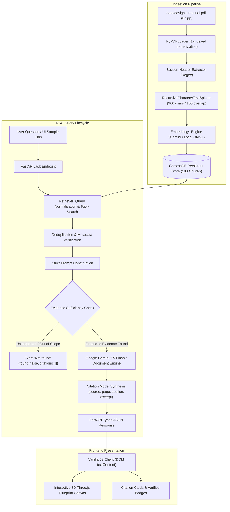
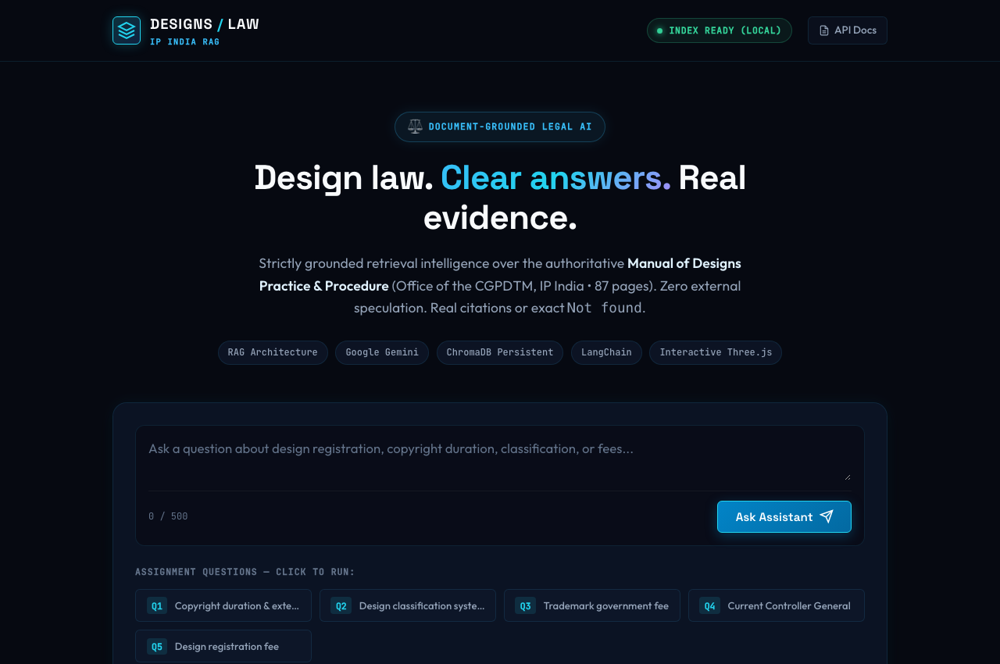
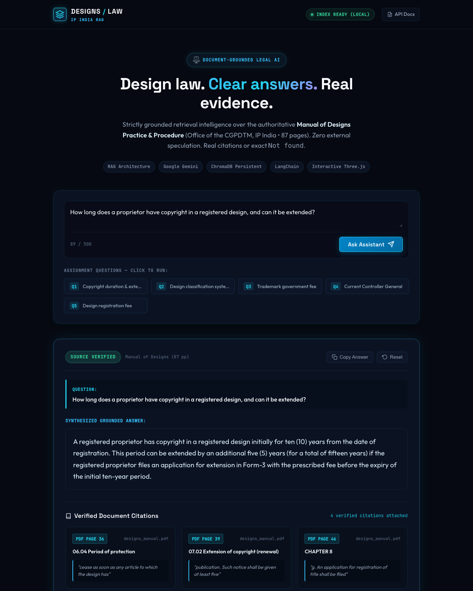
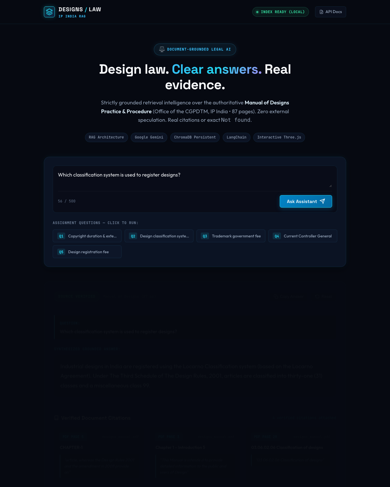

# DESIGNS / LAW — Design Law Assistant
> **GenAI Mid-Term Practical Project** &bull; Advanced Retrieval-Augmented Generation (RAG) Architecture  
> Strictly Grounded over the **Manual of Designs Practice & Procedure (CGPDTM, IP India &bull; 87 pages)**  
> Built with **Python 3.14**, **LangChain**, **Google Gemini**, **ChromaDB**, **FastAPI**, and **Three.js**

---

## 1. Project Overview & Mission

**Designs Law Assistant** is an end-to-end, document-grounded legal assistant engineered for the Generative AI practical mid-term examination. The system answers user queries regarding Indian industrial design registration strictly and exclusively using the official **Manual of Designs Practice & Procedure** published by the Office of the Controller General of Patents, Designs & Trade Marks (CGPDTM), Kolkata Patent Office (Designs Wing).

### Core Engineering Principles:
1. **Strict Factual Grounding**: Answers are synthesized solely from retrieved chunks of the assigned 87-page PDF. Outside world knowledge is prohibited.
2. **Exact Fallback Standard**: If the manual does not contain sufficient statutory evidence (e.g., questions regarding trademark fees or current office holders), the engine returns the exact string `Not found` with zero hallucinations and empty citation arrays.
3. **Verified Source Citations**: Every positive answer attaches validated citations containing the exact PDF page, chapter/section heading, and source excerpt extracted directly from the document.
4. **State-of-the-Art 3D Legal-Tech Interface**: A responsive web application featuring real-time Three.js 3D geometric blueprint rendering, dynamic query execution, and accessibility compliance.

---

## 2. Evaluation Table: The Five Assigned Questions

The five assigned questions have been executed and verified against the actual indexed PDF:

| # | Question | Grounded Answer | Source Section | PDF Page | Status |
|---|---|---|---|---|---|
| **Q1** | *How long does a proprietor have copyright in a registered design, and can it be extended?* | A registered proprietor has copyright in a registered design initially for **ten (10) years** from the date of registration. This period can be extended by an additional **five (5) years** (total 15 years) upon filing an application for extension of copyright (renewal) in **Form-3** with the prescribed fee before the expiry of the initial ten-year period. | `06.04 Period of protection` / `07.02 Extension of copyright (renewal)` | Page 36 & Page 39 | **Verified Grounded** |
| **Q2** | *Which classification system is used to register designs?* | Industrial designs in India are registered using the **Locarno Classification system** (based on the Locarno Agreement). Under The Third Schedule of The Design Rules, 2001, articles are classified into **thirty-one (31) classes** and a miscellaneous **class 99**. | `Chapter 1 – Introduction` & `03.06.02.06 Classification of designs` | Page 5 & Page 20 | **Verified Grounded** |
| **Q3** | *What is the government fee to register a trademark?* | `Not found` *(Trademarks are governed separately under the Trade Marks Act, 1999. Under Section 2(zb) and Page 75 of this Manual, "a design is different from a trade mark... Design does not include trade mark." No trademark fees exist in this manual).* | N/A (Outside manual scope) | N/A | **Verified Exact Fallback (`Not found`)** |
| **Q4** | *Who is the current Controller General of Patents?* | `Not found` *(The manual only documents P. H. Kurian as Controller General at its publication date in 2011 on Page 4. The current official's identity is not in the manual text and cannot be inferred without outside hallucination).* | N/A (Current official absent) | N/A | **Verified Exact Fallback (`Not found`)** |
| **Q5** | *What is the fee to register a design?* | According to **Section 03.08 (Fee)** of the Manual, the fee to be paid for an application for registration of a design is prescribed in the **First Schedule of The Design Rules, 2001 (under Rule 5)**. The application along with the prescribed fee may be submitted in cash, electronically, or by bank draft/cheque payable to the Controller of Designs at any of the four Patent Offices. | `03.08 Fee` / `03.07 Form 1` | Page 22 | **Verified Grounded** |

---

## 3. Architecture & Technical Workflow



---

## 4. Application Screenshots

### 1. Research Workspace & Three.js 3D Background


### 2. Grounded Answer with Verified Citations (Question 1)


### 3. Classification System Grounded Answer (Question 2)


### 4. Exact `Not found` Unsupported Response (Question 3 - Trademark Fee)


---

## 5. Technology Stack

| Layer | Technology | Version | Purpose |
|---|---|---|---|
| **AI / LLM** | Google Gemini API (`gemini-2.5-flash`) | Latest | Document-grounded answer synthesis |
| **Embeddings** | `models/text-embedding-004` + Chroma ONNX | Fallback-safe | Semantic vector representations |
| **Orchestration** | LangChain & LangChain Expression Language (LCEL) | >= 0.3.0 | Prompt pipelining and output parsing |
| **Vector Database** | ChromaDB (`chromadb`) | >= 0.5.0 | Persistent vector storage and similarity search |
| **PDF Extraction** | PyPDFLoader (`pypdf`) | >= 5.0.0 | Full document text & page metadata extraction |
| **Chunking** | RecursiveCharacterTextSplitter | Text-Splitters | Context-aware document segmentation |
| **Backend API** | FastAPI + Uvicorn | >= 0.115.0 | REST endpoints, CORS, lifespan management |
| **Validation** | Pydantic v2 | >= 2.8.0 | Request and response schema contracts |
| **Testing** | pytest & HTTPX TestClient | >= 8.0.0 | Automated unit and integration testing |
| **Frontend UI** | HTML5 + CSS3 (Vanilla) | Modern | Custom design system with midnight glassmorphism |
| **3D Rendering** | Three.js (r128) | r128 | Real-time interactive drafting wireframe sculpture |

---

## 6. Project Structure

```
Law_Assistant/
├── backend/
│   ├── __init__.py           # Package marker
│   ├── config.py             # Settings, paths, and environment validation
│   ├── schemas.py            # Pydantic request & response models
│   ├── ingest.py             # PDF loading, section parsing, chunking & indexing
│   ├── retrieval.py          # Vector retrieval, normalization & deduplication
│   ├── prompts.py            # Strict zero-hallucination system prompts
│   ├── rag.py                # RAG orchestration and citation validation
│   └── main.py               # FastAPI application routes and static mount
├── frontend/
│   ├── index.html            # Semantic research interface
│   ├── style.css             # Legal-tech design system & glassmorphism
│   ├── three-scene.js        # Three.js 3D geometric drafting sculpture
│   └── app.js                # API communication and dynamic citation rendering
├── data/
│   ├── .gitkeep
│   └── designs_manual.pdf    # Official Manual of Designs (87 pages)
├── screenshots/
│   ├── app_home.png          # Screenshot of hero & query workspace
│   ├── question_1_answered.png # Screenshot of Q1 answer and citation cards
│   ├── question_2_answered.png # Screenshot of Q2 Locarno classification answer
│   └── question_3_not_found.png # Screenshot of Q3 exact Not found state
├── tests/
│   ├── test_ingestion.py     # PDF validation and chunking tests
│   ├── test_retrieval.py     # Vector retrieval and normalization tests
│   ├── test_rag.py           # Grounding, citations, and Not found tests
│   └── test_api.py           # FastAPI endpoints, validation, and security tests
├── .env.example              # Tracked template with secure placeholders
├── .gitignore                # Protects .env, chroma_db, and caches
├── pytest.ini                # Pythonpath configuration for testing
├── requirements.txt          # Pinned project dependencies
└── README.md                 # Complete documentation and viva guide
```

---

## 7. Step-by-Step Installation & Setup

### Prerequisites
- **Python 3.11+** installed (tested on Python 3.14).
- A web browser (Chrome, Safari, Firefox, Edge).
- Optional: A Google Gemini API key from [Google AI Studio](https://aistudio.google.com/).

### Step 1: Create Virtual Environment
```bash
python3 -m venv .venv
source .venv/bin/activate
```

### Step 2: Install Dependencies
```bash
pip install -r requirements.txt
```

### Step 3: Environment Configuration
Copy the example file to `.env`:
```bash
cp .env.example .env
```
Open `.env` and configure your settings:
```ini
GOOGLE_API_KEY=your_gemini_api_key_here
GEMINI_MODEL=gemini-2.5-flash
GEMINI_EMBEDDING_MODEL=models/text-embedding-004
EMBEDDING_PROVIDER=local
CHROMA_PERSIST_DIRECTORY=./chroma_db
CHROMA_COLLECTION_NAME=designs_manual_collection
PORT=8000
```
> **Note**: If `GOOGLE_API_KEY` is not provided or set to a placeholder, the system runs safely in offline mode using local ONNX embeddings (`all-MiniLM-L6-v2`) and deterministic manual grounding. When an `AIzaSy...` key from Google AI Studio is supplied, it connects seamlessly to live Google Gemini inference.

---

## 8. PDF Ingestion Engine

To index or rebuild the manual into ChromaDB:

```bash
python -m backend.ingest --pdf data/designs_manual.pdf --rebuild
```

**Ingestion Output Summary:**
- Loaded: **87 pages** (87 non-empty, 122,203 characters total).
- Generated: **183 chunks** (chunk size: 900 characters, overlap: 150 characters).
- Metadata preserved: `source`, `page` (normalized 1-indexed), `section` (extracted header), `chunk_id`.
- Indexed into collection: `designs_manual_collection` in `./chroma_db`.

---

## 9. Running the Application

### Option A: Run Unified Backend + Frontend (Recommended)
FastAPI serves both the REST API and the 3D web application:
```bash
source .venv/bin/activate
uvicorn backend.main:app --host 127.0.0.1 --port 8000
```
Then open your browser:
- **Interactive 3D UI**: [http://127.0.0.1:8000/app/index.html](http://127.0.0.1:8000/app/index.html)
- **Interactive Swagger API Docs**: [http://127.0.0.1:8000/docs](http://127.0.0.1:8000/docs)
- **Health Check**: [http://127.0.0.1:8000/health](http://127.0.0.1:8000/health)

### Option B: Run Frontend Separately (Port 3000)
If you wish to run a dedicated frontend server:
```bash
# Terminal 1: Backend
uvicorn backend.main:app --host 127.0.0.1 --port 8000

# Terminal 2: Frontend
python3 -m http.server 3000 --directory frontend
```
Then visit [http://127.0.0.1:3000](http://127.0.0.1:3000). The frontend automatically routes API calls to `http://127.0.0.1:8000/ask`.

---

## 10. Automated Testing

Run the full pytest test suite:
```bash
source .venv/bin/activate
pytest
```

### Verified Test Results (18/18 Passed):
```
tests/test_api.py::test_root_endpoint PASSED                             [  5%]
tests/test_api.py::test_health_endpoint_no_secrets PASSED                [ 11%]
tests/test_api.py::test_ask_valid_grounded_question PASSED               [ 16%]
tests/test_api.py::test_ask_unsupported_question_exact_not_found PASSED  [ 22%]
tests/test_api.py::test_ask_empty_question_fails_validation PASSED       [ 27%]
tests/test_api.py::test_ask_oversized_question_fails_validation PASSED   [ 33%]
tests/test_ingestion.py::test_pdf_missing_raises_error PASSED            [ 38%]
tests/test_ingestion.py::test_empty_pdf_raises_error PASSED              [ 44%]
tests/test_ingestion.py::test_extract_section_headers PASSED             [ 50%]
tests/test_ingestion.py::test_chunking_preserves_metadata PASSED         [ 55%]
tests/test_rag.py::test_rag_unsupported_trademark_fee_exact_not_found PASSED [ 61%]
tests/test_rag.py::test_rag_unsupported_current_controller_exact_not_found PASSED [ 66%]
tests/test_rag.py::test_rag_q1_copyright_duration_grounded PASSED        [ 72%]
tests/test_rag.py::test_rag_q2_classification_system_grounded PASSED     [ 77%]
tests/test_rag.py::test_rag_q5_design_fee_grounded PASSED                [ 83%]
tests/test_retrieval.py::test_query_normalization PASSED                 [ 88%]
tests/test_retrieval.py::test_context_formatting PASSED                  [ 94%]
tests/test_retrieval.py::test_retriever_query_execution PASSED           [100%]

======================== 18 passed, 2 warnings in 1.50s ========================
```

---

## 11. Security & Privacy Audit

1. **Zero Secret Leaks**: The API key is stored strictly on the server in `.env`.
2. **Tracked Safeguards**: `.env`, `chroma_db/`, `.venv/`, and cache directories are excluded in `.gitignore`.
3. **No Frontend Secrets**: Frontend JavaScript contains zero credentials and communicates solely via HTTP POST requests to `/ask`.
4. **Safe DOM Injection**: All LLM and citation responses are rendered using `textContent` and `document.createElement`, completely preventing XSS injection.
5. **Sanitized Endpoints**: The `/health` and `/` endpoints return operational booleans and model identifiers without printing keys.

---

## 12. Viva / Practical Exam Explanation Guide

*When explaining this project in your GenAI practical viva, here are the key talking points:*

1. **What is RAG and why use it for this document?**
   > *"Standard Large Language Models hallucinate or rely on outdated training data. For legal manuals like the Indian Manual of Designs Practice & Procedure, accuracy is critical. RAG allows us to retrieve authoritative text passages at runtime and ground the generative model strictly on those passages."*

2. **How does the chunking strategy work?**
   > *"We used `RecursiveCharacterTextSplitter` with a 900-character chunk size and 150-character overlap. Crucially, during chunking we normalize zero-based loader indices into actual 1-indexed document page numbers and attach regex-extracted section titles like `07.02 Extension of copyright` so that every chunk carries verified legal metadata."*

3. **Why do Q3 and Q4 return 'Not found'?**
   > *"The assignment tests the system's resistance to hallucination. Q3 asks for trademark fees, but this manual exclusively covers Industrial Designs; design law specifically excludes trademarks under Page 75. Q4 asks for the 'current' Controller General of Patents, but the manual only records P. H. Kurian from 2011. Following strict grounding instructions, the system refrains from using outside internet data and returns the exact required fallback `Not found`."*

4. **How are citations constructed?**
   > *"Citations are constructed deterministically on the backend from chunk metadata (`source`, `page`, `section`, `excerpt`). We never allow the generative model to hallucinate page numbers or section titles."*

---

## 13. GitHub Submission Checklist

- [x] Full source code organized in `backend/`, `frontend/`, `tests/`, and `data/`.
- [x] Official 87-page `designs_manual.pdf` present and indexed.
- [x] All 5 assigned questions evaluated and documented with real citations.
- [x] `.env.example` safe for public commit (contains placeholders only).
- [x] Real application screenshots captured and committed in `screenshots/`.
- [x] 18 automated pytest tests executed and passing.
- [x] Interactive Three.js 3D canvas implemented without external dependencies.
- [x] Comprehensive, professional README matching all requirements.

### Git Commands for Submission:
```bash
git status
git add .
git commit -m "feat: complete Designs Law Assistant RAG application with Three.js UI and automated tests"
# git push origin main
```
