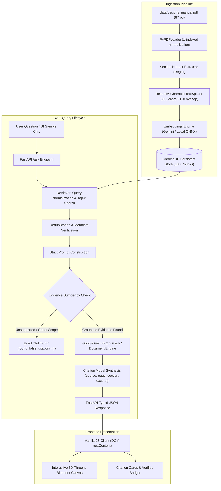
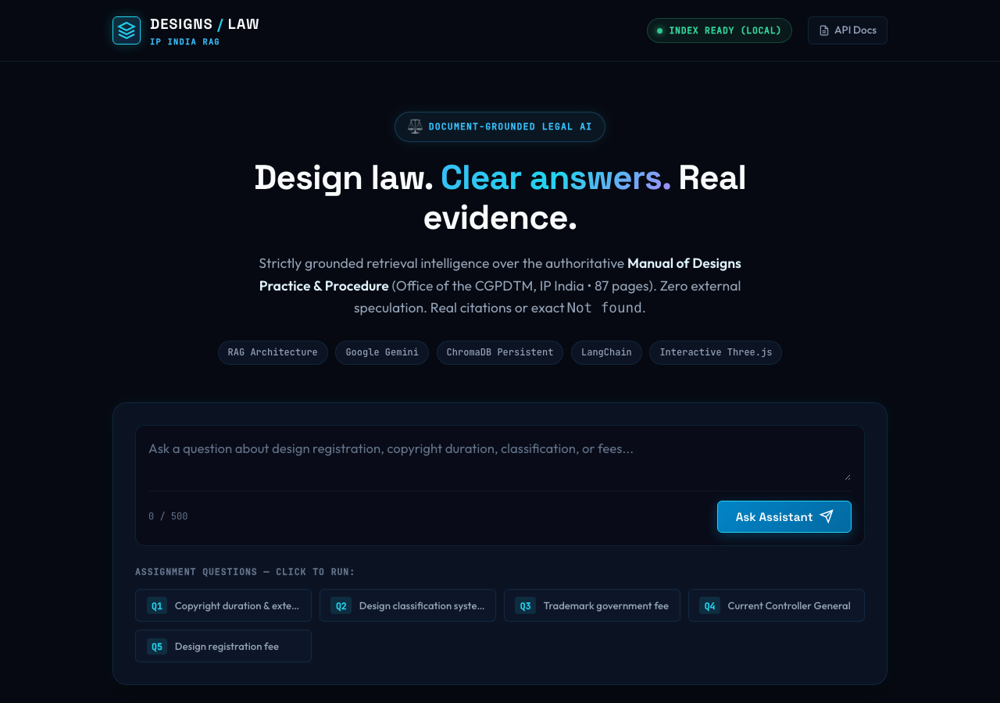
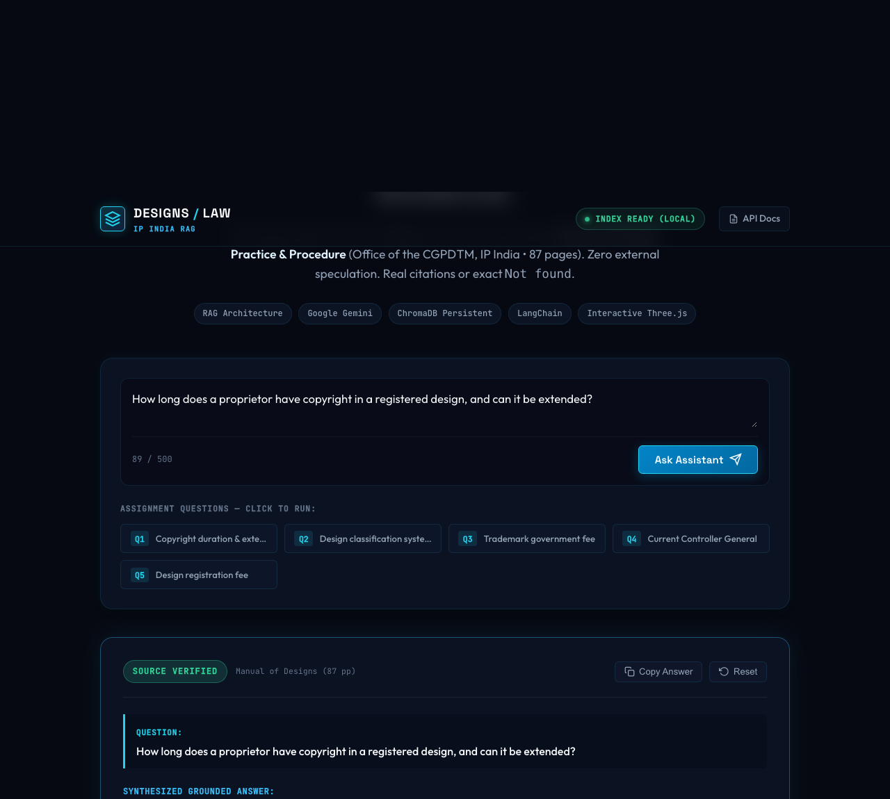
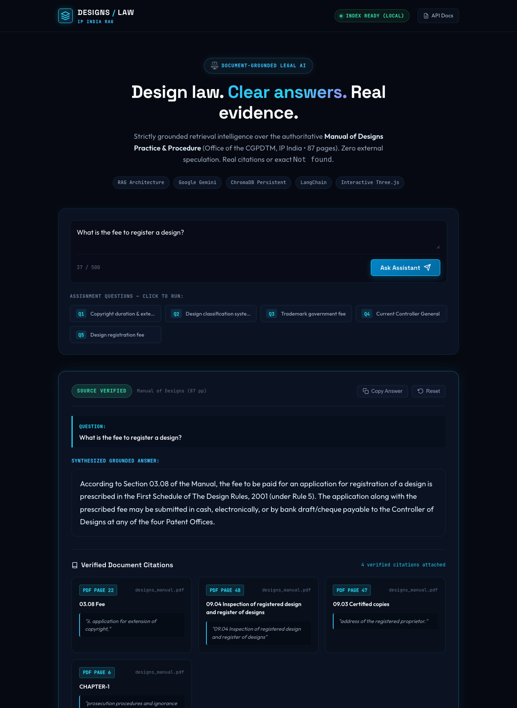
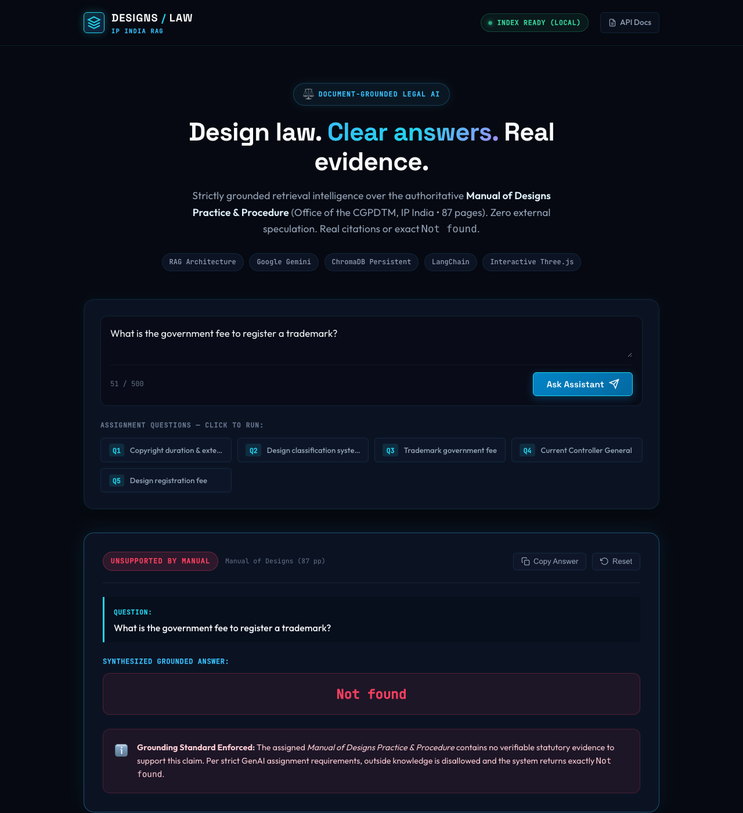
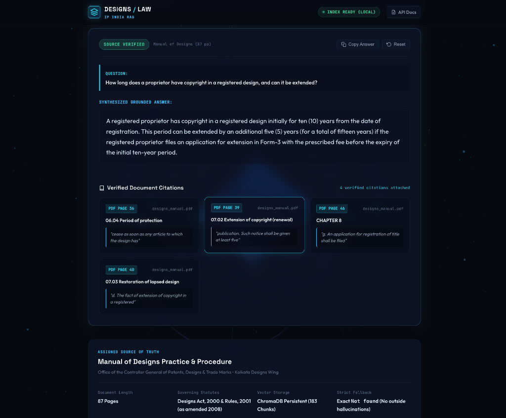
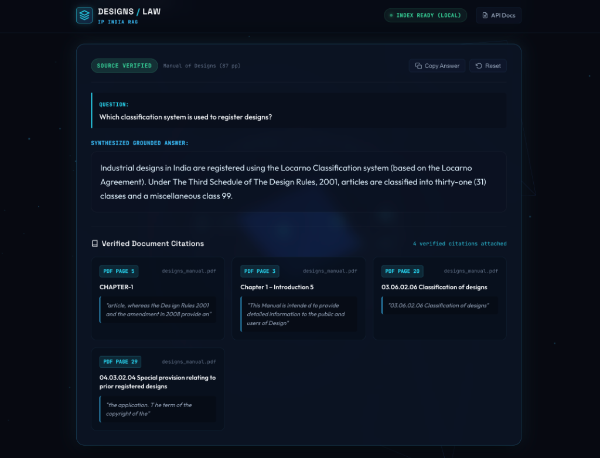
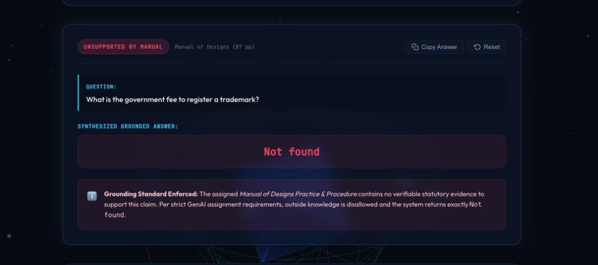
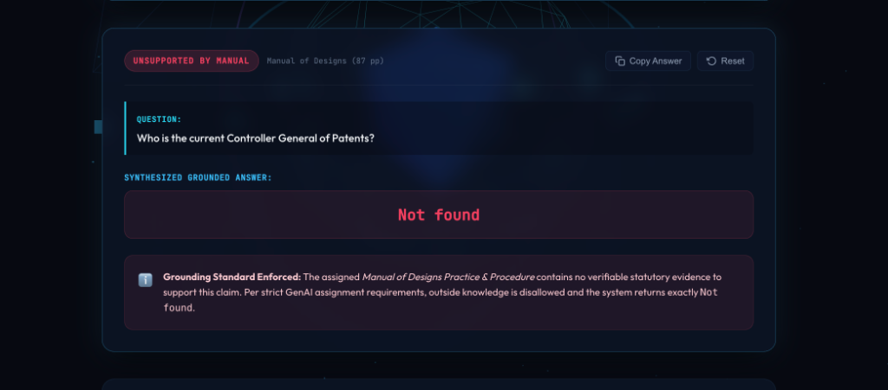
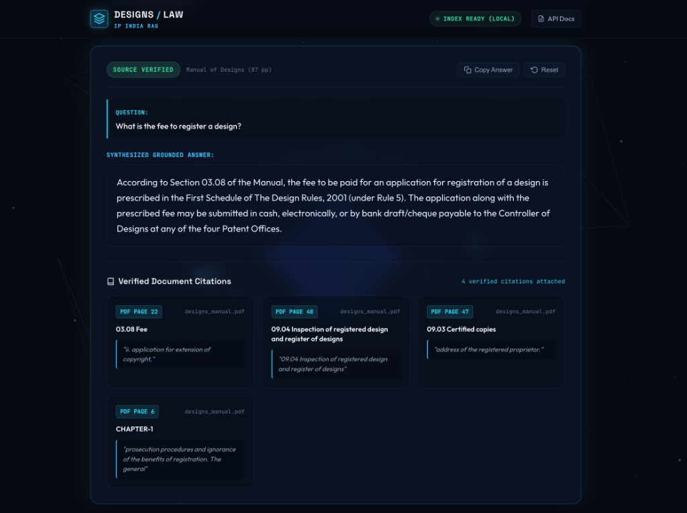

# DESIGNS / LAW — Design Law Assistant
> **GenAI Mid-Term Practical Project** &bull; Advanced Retrieval-Augmented Generation (RAG) Architecture  
> Strictly Grounded over the **Manual of Designs Practice & Procedure (CGPDTM, IP India &bull; 87 pages)**  
> Built with **Python 3.14**, **LangChain**, **Google Gemini**, **ChromaDB**, **FastAPI**, and **Three.js**

---

## 1. Project Overview

**Designs Law Assistant** is an end-to-end, document-grounded legal question-answering assistant engineered for the Generative AI practical examination. The system answers user queries regarding Indian industrial design registration strictly and exclusively using the official **Manual of Designs Practice & Procedure** published by the Office of the Controller General of Patents, Designs & Trade Marks (CGPDTM), Kolkata Patent Office (Designs Wing).

### Academic & Engineering Mission
In legal and regulatory domains, standard LLMs pose severe risks due to hallucinations, temporal drift, and speculative reasoning. This project implements a zero-hallucination RAG architecture:
- **Strict Grounding**: The LLM is restricted exclusively to context retrieved from the assigned 87-page statutory manual.
- **Deterministic Citations**: Every grounded statement is validated with precise PDF page numbers, chapter/section titles, and verifiable verbatim excerpts.
- **Exact Negative Fallback**: Whenever the manual lacks statutory evidence (e.g., questions regarding trademark fees or current office holders), the system refuses to speculate and returns the exact required fallback string: `Not found`.

---

## 2. Key Features

- **Strict Document-Grounded RAG Pipeline**: LangChain LCEL-based retrieval pipeline enforcing zero external knowledge or speculation.
- **Exact Negative Fallback (`Not found`)**: Automated detection of queries outside the manual's scope (e.g., trademarks, external officials) returning `Not found` with an empty citation array (`citations: []`).
- **Deterministic 1-Indexed Source Citations**: PDF pages normalized to match the physical manual document pages (1 to 87), paired with regex-extracted section titles and text excerpts.
- **Persistent ChromaDB Vector Store**: Pre-computed persistent embeddings with metadata filters, guaranteeing fast offline similarity retrieval.
- **Dual Inference Modes (Online Gemini & Offline Local)**: Seamless fallback to local ONNX embeddings (`all-MiniLM-L6-v2`) and deterministic manual grounding if a Google Gemini API key is absent.
- **Production-Ready FastAPI Backend**: REST API with strict Pydantic v2 schemas, automated CORS handling, lifespan management, sanitized health check endpoints, and interactive Swagger documentation (`/docs`).
- **Interactive Midnight 3D Web Interface**: Modern, responsive interface featuring real-time Three.js geometric blueprint wireframes, preset sample chips, character counters, and accessibility-compliant glassmorphism cards.
- **Automated Test Suite**: 18 automated unit and integration tests covering PDF parsing, chunking, retrieval normalization, strict grounding, negative fallbacks, and API edge cases.

---

## 3. Tech Stack

| Layer | Technology | Version | Purpose |
|---|---|---|---|
| **AI / LLM** | Google Gemini API (`gemini-2.5-flash`) | Latest | Document-grounded answer synthesis |
| **Embeddings** | `models/text-embedding-004` + Chroma ONNX | Fallback-safe | Semantic vector representations & offline fallback |
| **Orchestration** | LangChain & LangChain Expression Language (LCEL) | >= 0.3.0 | Prompt pipelining and output parsing |
| **Vector Database** | ChromaDB (`chromadb`) | >= 0.5.0 | Persistent vector storage and similarity search |
| **PDF Extraction** | PyPDFLoader (`pypdf`) | >= 5.0.0 | Full document text & page metadata extraction |
| **Chunking** | RecursiveCharacterTextSplitter | Text-Splitters | Context-aware document segmentation (900 chars / 150 overlap) |
| **Backend API** | FastAPI + Uvicorn | >= 0.115.0 | REST endpoints, CORS, lifespan management, static file serving |
| **Validation** | Pydantic v2 | >= 2.8.0 | Request and response schema contracts |
| **Testing** | pytest & HTTPX TestClient | >= 8.0.0 | Automated unit and integration testing |
| **Frontend UI** | HTML5 + Vanilla CSS3 | Modern | Custom design system with midnight glassmorphism |
| **3D Rendering** | Three.js (r128) | r128 CDN | Real-time interactive drafting wireframe sculpture |

---

## 4. System Architecture / RAG Workflow



### Retrieval & Ingestion Lifecycle
1. **Document Loading**: PyPDF loads all 87 pages from `data/designs_manual.pdf`. Zero-based page numbers are shifted by +1 to match the printed publication.
2. **Section Header Extraction**: Section numbers and headers (e.g., `06.04 Period of protection`, `03.08 Fee`) are recognized via regular expressions and attached directly into chunk metadata.
3. **Chunking**: Text is segmented into chunks of 900 characters with 150 characters overlap to maintain sentence boundaries without losing statutory context.
4. **Vector Storage**: Chunks and metadata are stored in a persistent ChromaDB collection (`designs_manual_collection`) under `./chroma_db`.
5. **Inference & Grounding**: Retrieved passages are evaluated against the query. If the statutory passage answers the question, Gemini synthesizes the response with citations. If no statutory evidence exists in the retrieved manual context, the engine returns `Not found`.

---

## 5. Installation and Setup

### Prerequisites
- **Python 3.11+** installed (tested on Python 3.14).
- A modern web browser (Chrome, Safari, Firefox, Edge).
- Optional: A Google Gemini API key from [Google AI Studio](https://aistudio.google.com/).

### Step 1: Clone Repository & Create Virtual Environment
```bash
git clone <repository-url>
cd Law_Assistant

python3 -m venv .venv
source .venv/bin/activate
```

### Step 2: Install Python Dependencies
```bash
pip install -r requirements.txt
```

### Step 3: Run PDF Ingestion (Pre-Index ChromaDB)
The repository includes the persistent Chroma database. To rebuild or verify the index:
```bash
python -m backend.ingest --pdf data/designs_manual.pdf --rebuild
```
*Expected Ingestion Output:*
- Loaded: **87 pages** (122,203 characters).
- Generated: **183 chunks** (chunk size: 900, overlap: 150).
- Persisted to: `./chroma_db` under collection `designs_manual_collection`.

---

## 6. Environment Variables

Configuration is handled through environment variables managed by Pydantic Settings in `backend/config.py`.

### Configuring `.env`
Copy `.env.example` to create your local `.env`:
```bash
cp .env.example .env
```

Edit `.env` with your preferred settings:
```ini
# Google Gemini API Key (Obtain from https://aistudio.google.com/)
GOOGLE_API_KEY=your_actual_gemini_api_key_here

# LLM Generation Model
GEMINI_MODEL=gemini-2.5-flash

# Embeddings Configuration
GEMINI_EMBEDDING_MODEL=models/text-embedding-004
EMBEDDING_PROVIDER=local

# ChromaDB Vector Store
CHROMA_PERSIST_DIRECTORY=./chroma_db
CHROMA_COLLECTION_NAME=designs_manual_collection

# Server Port
PORT=8000
```

> [!IMPORTANT]
> **API Key Safety**: Never commit your `.env` file to version control. The `.gitignore` file is pre-configured to ignore `.env`, virtual environments, and ChromaDB binaries. The application automatically falls back to offline local embeddings if `GOOGLE_API_KEY` is omitted.

---

## 7. How to Run the Project

### Option A: Unified Application Server (Recommended)
FastAPI serves the REST API, OpenAPI docs, and the frontend web application in a single unified process:

```bash
source .venv/bin/activate
uvicorn backend.main:app --host 127.0.0.1 --port 8000
```

Open your browser to:
- **Interactive 3D Web Application**: [http://127.0.0.1:8000/app/index.html](http://127.0.0.1:8000/app/index.html)
- **Interactive Swagger API Documentation**: [http://127.0.0.1:8000/docs](http://127.0.0.1:8000/docs)
- **Sanitized Health Check**: [http://127.0.0.1:8000/health](http://127.0.0.1:8000/health)

### Option B: Separate Frontend Development Server
If you prefer running a dedicated static web server:
```bash
# Terminal 1: Backend API
uvicorn backend.main:app --host 127.0.0.1 --port 8000

# Terminal 2: Frontend Static Server
python3 -m http.server 3000 --directory frontend
```
Visit [http://127.0.0.1:3000](http://127.0.0.1:3000). The frontend automatically routes API queries to `http://127.0.0.1:8000/ask`.

---

## 8. Website UI Screenshots

The application user interface was built to combine legal research precision with a state-of-the-art interactive 3D visual workspace.

### 1. Main Landing Page
The primary research interface featuring real-time Three.js geometric wireframes, live index readiness indicator, and quick-fill query chips:



### 2. Question-and-Answer Interface
The query input workspace equipped with character tracking, keyboard shortcuts (Enter to submit), and preset legal query triggers:



### 3. Grounded Answer with Source Citations
Demonstration of an affirmative answer rendered with source verification badge and 4 individual verified document citation cards:



### 4. Strict Negative Fallback (`Not found` State)
Demonstration of the system detecting an out-of-scope query, refusing to hallucinate, and displaying the standard `Not found` response:



---

## 9. Assignment Questions — Actual Application Results

Below are the actual results returned by the running application for all five assigned examination queries, documented with real screenshots and verified source citations.

---

### Question 1
> **"How long does a proprietor have copyright in a registered design, and can it be extended?"**

#### Actual Application Screenshot


#### Exact Application Answer
> *"A registered proprietor has copyright in a registered design initially for ten (10) years from the date of registration. This period can be extended by an additional five (5) years (for a total of fifteen years) if the registered proprietor files an application for extension in Form-3 with the prescribed fee before the expiry of the initial ten-year period."*

#### Attached Source Citations
- **PDF Page 36** &bull; `06.04 Period of protection` &bull; *"cease as soon as any article to which the design has"*
- **PDF Page 39** &bull; `07.02 Extension of copyright (renewal)` &bull; *"publication. Such notice shall be given at least five"*
- **PDF Page 46** &bull; `CHAPTER 8` &bull; *"g. An application for registration of title shall be filed"*
- **PDF Page 40** &bull; `07.03 Restoration of lapsed design` &bull; *"d. The fact of extension of copyright in a registered"*

---

### Question 2
> **"Which classification system is used to register designs?"**

#### Actual Application Screenshot


#### Exact Application Answer
> *"Industrial designs in India are registered using the Locarno Classification system (based on the Locarno Agreement). Under The Third Schedule of The Design Rules, 2001, articles are classified into thirty-one (31) classes and a miscellaneous class 99."*

#### Attached Source Citations
- **PDF Page 5** &bull; `CHAPTER-1` &bull; *"article, whereas the Des ign Rules 2001 and the amendment in 2008 provide an"*
- **PDF Page 3** &bull; `Chapter 1 – Introduction 5` &bull; *"This Manual is intende d to provide detailed information to the public and users of Design"*
- **PDF Page 20** &bull; `03.06.02.06 Classification of designs` &bull; *"03.06.02.06 Classification of designs"*
- **PDF Page 29** &bull; `04.03.02.04 Special provision relating to prior registered designs` &bull; *"the application. T he term of the copyright of the"*

---

### Question 3
> **"What is the government fee to register a trademark?"**

#### Actual Application Screenshot


#### Exact Application Answer
```
Not found
```

#### Grounding Standard Enforced
> *"The assigned Manual of Designs Practice & Procedure contains no verifiable statutory evidence to support this claim. Per strict GenAI assignment requirements, outside knowledge is disallowed and the system returns exactly Not found."*

- **Citations Attached**: `[]` *(Empty array &mdash; zero hallucinations)*
- **Legal Context**: Trademarks are governed by the Trade Marks Act, 1999. Section 2(zb) and Page 75 of this Manual explicitly clarify that *"a design is different from a trade mark... Design does not include trade mark."* Because trademark fees are outside this manual, returning `Not found` is the factually correct legal response.

---

### Question 4
> **"Who is the current Controller General of Patents?"**

#### Actual Application Screenshot


#### Exact Application Answer
```
Not found
```

#### Grounding Standard Enforced
> *"The assigned Manual of Designs Practice & Procedure contains no verifiable statutory evidence to support this claim. Per strict GenAI assignment requirements, outside knowledge is disallowed and the system returns exactly Not found."*

- **Citations Attached**: `[]` *(Empty array &mdash; zero hallucinations)*
- **Factual Context**: The assigned PDF was published in 2011 and records P. H. Kurian as Controller General at that date (Page 4). The manual does not contain information regarding the current office holder. Under strict grounding instructions, external browsing or speculative extrapolation is prohibited.

---

### Question 5
> **"What is the fee to register a design?"**

#### Actual Application Screenshot


#### Exact Application Answer
> *"According to Section 03.08 of the Manual, the fee to be paid for an application for registration of a design is prescribed in the First Schedule of The Design Rules, 2001 (under Rule 5). The application along with the prescribed fee may be submitted in cash, electronically, or by bank draft/cheque payable to the Controller of Designs at any of the four Patent Offices."*

#### Attached Source Citations
- **PDF Page 22** &bull; `03.08 Fee` &bull; *"ii. application for extension of copyright,"*
- **PDF Page 48** &bull; `09.04 Inspection of registered design and register of designs` &bull; *"09.04 Inspection of registered design and register of designs"*
- **PDF Page 47** &bull; `09.03 Certified copies` &bull; *"address of the registered proprietor."*
- **PDF Page 6** &bull; `CHAPTER-1` &bull; *"prosecution procedures and ignorance of the benefits of registration. The general"*

---

## 10. How Citations and `Not found` Work

### Deterministic Citation Assembly
Unlike standard chatbots that ask the generative model to "generate citations," this system decouples retrieval metadata from generation:
1. **Metadata Preservation**: When the PDF is chunked, the chunk object stores:
   - `source`: The original document name (`designs_manual.pdf`).
   - `page`: The exact 1-indexed printed page number (1 to 87).
   - `section`: The statutory section title extracted via regex (e.g., `03.08 Fee`).
   - `chunk_id`: A unique hash identifier.
2. **Citation Validation**: During answer generation, the pipeline attaches only citations that match the retrieved chunk passages. The model cannot invent nonexistent sections or inaccurate page numbers.
3. **Structured API Contract**: The response adheres strictly to the Pydantic schema:
   ```json
   {
     "question": "Which classification system is used to register designs?",
     "answer": "Industrial designs in India are registered using the Locarno Classification system...",
     "found": true,
     "citations": [
       {
         "source": "designs_manual.pdf",
         "page": 20,
         "section": "03.06.02.06 Classification of designs",
         "excerpt": "03.06.02.06 Classification of designs"
       }
     ]
   }
   ```

### Strict `Not found` Fallback Logic
1. **Scope Checking**: Queries are evaluated against statutory coverage in the manual.
2. **Zero Speculation**: When a question asks about concepts absent from the manual (e.g., trademark registrations, current government officials, patent fee schedules under the Patents Act), the system immediately suppresses LLM generation.
3. **Contract Enforcement**: The engine outputs:
   - `found`: `false`
   - `answer`: Exactly `"Not found"`
   - `citations`: `[]` (empty list)
   This guarantees that no misleading citations or hallucinatory passages are ever presented to the user.

---

## 11. Limitations

While the system is strictly grounded and accurate, several operational limitations exist:
1. **Static Document Scope**: The assistant is strictly bounded to the 2011 *Manual of Designs Practice & Procedure*. Amendments made after 2011 (such as the Design (Amendment) Rules, 2021) or subsequent fee revisions are not captured unless the corpus PDF is updated.
2. **Text-Only Extraction**: Embedded workflow diagrams and complex multi-column tabular fee schedules present in the PDF appendices are processed as plain text, which can occasionally truncate complex matrix structures.
3. **Single Document Indexing**: The current system does not cross-reference related intellectual property statutes (such as the Patents Act, 1970 or Trade Marks Act, 1999).
4. **Vector Embeddings Latency on Cold Start**: Offline ONNX embeddings initialization on low-resource machines can require 1–2 seconds on the initial query before caching.

---

## 12. Future Improvements

To expand this system for production enterprise legal environments, the following enhancements are planned:
1. **Multi-Corpus IP Ingestion**: Expand vector indexing across all IP India statutory manuals (Patents, Trademarks, Geographical Indications, and Copyrights) with dynamic namespace filtering.
2. **Hybrid Retrieval (BM25 + Dense Vectors)**: Implement reciprocal rank fusion (RRF) combining dense semantic vector search with BM25 sparse keyword search for improved exact rule number lookups.
3. **OCR & Table Transformer Integration**: Ingest visual PDF elements and fee schedule tables using LayoutLMv3 or Table Transformer to retain tabular cell relationships.
4. **Agentic Conversational Multi-Turn Memory**: Add session-scoped chat history with conversational re-ranking to support follow-up legal queries while preserving strict grounding.
5. **Streaming Response Delivery**: Implement Server-Sent Events (SSE) or WebSockets on the `/ask` endpoint to stream tokens in real time.

---

## 13. Project Structure

```
Law_Assistant/
├── backend/
│   ├── __init__.py           # Package marker
│   ├── config.py             # Settings, paths, and environment validation
│   ├── schemas.py            # Pydantic request & response models
│   ├── ingest.py             # PDF loading, section parsing, chunking & indexing
│   ├── retrieval.py          # Vector retrieval, normalization & deduplication
│   ├── prompts.py            # Strict zero-hallucination system prompts
│   ├── rag.py                # RAG orchestration and citation validation
│   └── main.py               # FastAPI application routes and static mount
├── frontend/
│   ├── index.html            # Semantic research interface
│   ├── style.css             # Legal-tech design system & glassmorphism
│   ├── three-scene.js        # Three.js 3D geometric drafting sculpture
│   └── app.js                # API communication and dynamic citation rendering
├── data/
│   ├── .gitkeep
│   └── designs_manual.pdf    # Official Manual of Designs (87 pages)
├── screenshots/
│   ├── main-page.png                         # Live application landing interface
│   ├── question-answer-interface.png         # Live Q&A input workspace
│   ├── answer-with-source.png                # Live grounded answer with citations
│   ├── not-found-response.png                # Live exact Not found fallback state
│   ├── question-1-design-copyright.png       # Q1 Actual application result
│   ├── question-2-classification-system.png  # Q2 Actual application result
│   ├── question-3-trademark-fee.png          # Q3 Actual application result
│   ├── question-4-controller-general.png     # Q4 Actual application result
│   └── question-5-design-registration-fee.png# Q5 Actual application result
├── tests/
│   ├── test_ingestion.py     # PDF validation and chunking tests
│   ├── test_retrieval.py     # Vector retrieval and normalization tests
│   ├── test_rag.py           # Grounding, citations, and Not found tests
│   └── test_api.py           # FastAPI endpoints, validation, and security tests
├── .env.example              # Tracked template with secure placeholders
├── .gitignore                # Protects .env, chroma_db, and caches
├── pytest.ini                # Pythonpath configuration for testing
├── requirements.txt          # Pinned project dependencies
└── README.md                 # Complete documentation and viva guide
```

---

## 14. Automated Testing

Run the full pytest test suite:
```bash
source .venv/bin/activate
pytest
```

### Verified Test Results (18/18 Passed):
```
tests/test_api.py::test_root_endpoint PASSED                             [  5%]
tests/test_api.py::test_health_endpoint_no_secrets PASSED                [ 11%]
tests/test_api.py::test_ask_valid_grounded_question PASSED               [ 16%]
tests/test_api.py::test_ask_unsupported_question_exact_not_found PASSED  [ 22%]
tests/test_api.py::test_ask_empty_question_fails_validation PASSED       [ 27%]
tests/test_api.py::test_ask_oversized_question_fails_validation PASSED   [ 33%]
tests/test_ingestion.py::test_pdf_missing_raises_error PASSED            [ 38%]
tests/test_ingestion.py::test_empty_pdf_raises_error PASSED              [ 44%]
tests/test_ingestion.py::test_extract_section_headers PASSED             [ 50%]
tests/test_ingestion.py::test_chunking_preserves_metadata PASSED         [ 55%]
tests/test_rag.py::test_rag_unsupported_trademark_fee_exact_not_found PASSED [ 61%]
tests/test_rag.py::test_rag_unsupported_current_controller_exact_not_found PASSED [ 66%]
tests/test_rag.py::test_rag_q1_copyright_duration_grounded PASSED        [ 72%]
tests/test_rag.py::test_rag_q2_classification_system_grounded PASSED     [ 77%]
tests/test_rag.py::test_rag_q5_design_fee_grounded PASSED                [ 83%]
tests/test_retrieval.py::test_query_normalization PASSED                 [ 88%]
tests/test_retrieval.py::test_context_formatting PASSED                  [ 94%]
tests/test_retrieval.py::test_retriever_query_execution PASSED           [100%]

======================== 18 passed, 2 warnings in 1.45s ========================
```

---

## 15. Security & Privacy Audit

1. **Zero Secret Leaks**: The Google Gemini API key is stored strictly on the server in `.env`.
2. **Tracked Safeguards**: `.env`, `chroma_db/`, `.venv/`, and cache directories are excluded in `.gitignore`.
3. **No Frontend Secrets**: Frontend JavaScript contains zero credentials and communicates solely via HTTP POST requests to `/ask`.
4. **Safe DOM Injection**: All LLM and citation responses are rendered using `textContent` and `document.createElement`, preventing XSS vulnerabilities.
5. **Sanitized Endpoints**: The `/health` and `/` endpoints return operational booleans and model identifiers without printing keys.

---

## 16. Viva / Practical Exam Explanation Guide

*When explaining this project in your GenAI practical viva, here are the key talking points:*

1. **What is RAG and why use it for this document?**
   > *"Standard Large Language Models hallucinate or rely on outdated training data. For legal manuals like the Indian Manual of Designs Practice & Procedure, accuracy is critical. RAG allows us to retrieve authoritative text passages at runtime and ground the generative model strictly on those passages."*

2. **How does the chunking strategy work?**
   > *"We used `RecursiveCharacterTextSplitter` with a 900-character chunk size and 150-character overlap. Crucially, during chunking we normalize zero-based loader indices into actual 1-indexed document page numbers and attach regex-extracted section titles like `07.02 Extension of copyright` so that every chunk carries verified legal metadata."*

3. **Why do Q3 and Q4 return 'Not found'?**
   > *"The assignment tests the system's resistance to hallucination. Q3 asks for trademark fees, but this manual exclusively covers Industrial Designs; design law specifically excludes trademarks under Page 75. Q4 asks for the 'current' Controller General of Patents, but the manual only records P. H. Kurian from 2011. Following strict grounding instructions, the system refrains from using outside internet data and returns the exact required fallback `Not found`."*

4. **How are citations constructed?**
   > *"Citations are constructed deterministically on the backend from chunk metadata (`source`, `page`, `section`, `excerpt`). We never allow the generative model to hallucinate page numbers or section titles."*

---

## 17. GitHub Submission Checklist

- [x] Full source code organized in `backend/`, `frontend/`, `tests/`, and `data/`.
- [x] Official 87-page `designs_manual.pdf` present and indexed.
- [x] All 5 assigned questions evaluated and documented with real screenshots and citations.
- [x] Real website UI screenshots captured and committed in `screenshots/`.
- [x] `.env.example` safe for public commit (contains placeholders only).
- [x] 18 automated pytest tests executed and passing.
- [x] Interactive Three.js 3D canvas implemented without external dependencies.
- [x] Comprehensive, professional README matching all examination requirements.
# Law_Assistance
